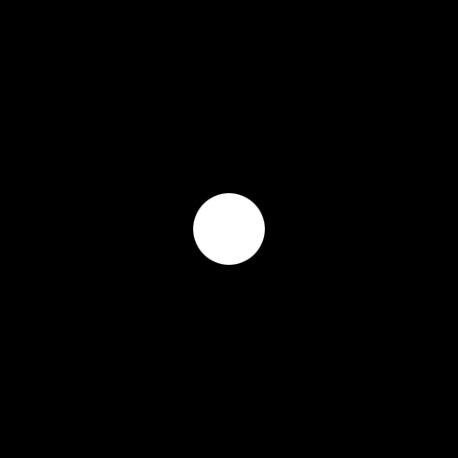

# comfyui-logo-inject

Made by Yovan Vujacic. ComfyUI custom nodes for the Workflow Studio **Logo Inject** tool: it puts a brand
badge onto a car render at the spots the user paints. It erases the old emblem, places the exact logo in
perspective, gives it a real badge finish, and keeps the original pixels everywhere else.

- Main node: **`LogoInjectV2`** (category `Logo Inject`). This is the only node the Logo Inject tool uses.
- October 2026 release = git tag **`v2.0.0`**. Latest: **`v2.0.2`** (see Changes below).
- Nothing downloads at runtime. The node makes no network calls.

## Install

```bash
cd ComfyUI/custom_nodes
git clone https://github.com/yovsac/comfyui-logo-inject.git
cd comfyui-logo-inject && git checkout v2.0.0
pip install -r requirements.txt     # opencv-python, numpy
# restart ComfyUI
```

**Python packages:** `opencv-python` and `numpy`, plus `torch`, which ComfyUI already has. Any OpenCV 4.x
build works (`opencv-python`, `-headless` or `-contrib`), since only core `cv2` functions are used. If the image
already has one of those, don't install a second one, because two OpenCV wheels in one environment clash.

## Tested on

| | Version |
|---|---|
| ComfyUI | 0.39.0 |
| Python / PyTorch | 3.13.9 / 2.9.1+cu130 |
| OpenCV / NumPy | 4.12.0 / 2.2.6 |
| GPU | RTX 5090 (32 GB). The Q8 GGUF model below is ~21.8 GB. |

## Other node packs the Logo Inject tool needs

| Pack | Repo | Commit we tested | Used for |
|---|---|---|---|
| ComfyUI-GGUF | https://github.com/city96/ComfyUI-GGUF | `6ea2651e7df66d7585f6ffee804b20e92fb38b8a` | `UnetLoaderGGUF` |
| ComfyUI-DepthAnythingV3 | https://github.com/PozzettiAndrea/ComfyUI-DepthAnythingV3 | `97af5c873e63a11a2cc2d8af93a3a5d927e044a0` | `DownloadAndLoadDepthAnythingV3Model`, `DepthAnything_V3` |
| RES4LYF | https://github.com/ClownsharkBatwing/RES4LYF | `0dc91c00c4c3fb38e7874fcd7a2a327765e8882c` | only the `beta57` scheduler, which `LogoInjectV2` samples with |
| rgthree-comfy | https://github.com/rgthree/rgthree-comfy | `8ff50e4521881eca1fe26aec9615fc9362474931` | `Seed (rgthree)` (panel seed) |
| comfyui-mixlab-nodes | https://github.com/shadowcz007/comfyui-mixlab-nodes | `fe8b526bbb62262a226ad25bd7e8d5b110532bc4` (v0.46.0) | `AppInfo` (Workflow Studio panel) |

Also used, all native to ComfyUI 0.39: `SAM3_Detect`, `CheckpointLoaderSimple`, `LoraLoaderModelOnly`,
`ModelSamplingAuraFlow`, `CFGNorm`, `CLIPLoader`, `VAELoader`, `ImageScaleToTotalPixels`, `PrimitiveString`,
`SaveImageWebsocket` (`custom_nodes/websocket_image_save.py`, ships with ComfyUI).

## Models

The JSON value is the path relative to the loader's own folder, so `qwen\X` means `models/loras/qwen/X`.

| File | Put it in | Size | Source |
|---|---|---|---|
| `Logo_Inject_Erase.safetensors` | `models/loras/qwen/` | 590 MB | **ours**, comes with the Logo Inject workflow release · md5 `909ae68955def36580d10e14bef46842` |
| `Logo_Inject_Finish.safetensors` | `models/loras/qwen/` | 590 MB | **ours**, comes with the Logo Inject workflow release · md5 `489de85eb80123bc3ac79b3026ab26ac` |
| `qwen-image-edit-2511-Q8_0.gguf` | `models/unet/QWEN/` | 21.8 GB | https://huggingface.co/unsloth/Qwen-Image-Edit-2511-GGUF |
| `qwen_2.5_vl_7b_fp8_scaled.safetensors` | `models/text_encoders/` | 9.4 GB | https://huggingface.co/Comfy-Org/Qwen-Image_ComfyUI (`split_files/text_encoders/`) |
| `qwen_image_vae.safetensors` | `models/vae/` | 254 MB | https://huggingface.co/Comfy-Org/Qwen-Image_ComfyUI (`split_files/vae/`) |
| `sam3.pt` | `models/checkpoints/sam3/` | 3.45 GB | https://huggingface.co/facebook/sam3 (gated, accept the licence on HF first) |
| `da3_large.safetensors` | `models/depthanything3/` | 1.64 GB | https://huggingface.co/depth-anything/DA3-LARGE-1.1 (`model.safetensors`, renamed). The DA3 node downloads it on first run, so place it by hand on an offline box. |

Every public file above matches the source byte-for-byte (size checked against Hugging Face). The two LoRAs
are not part of this repo: installing the node pack doesn't need them.

## How the tool wires it

`example_workflows/logo_inject_api.json` is the exact graph of the Workflow Studio tool, in API format. In short:

- `erase_model` = Qwen-Image-Edit-2511 + `Logo_Inject_Erase` LoRA → `ModelSamplingAuraFlow` (shift 3.1) → `CFGNorm` (1.0).
- `finish_model` = the same base + `Logo_Inject_Finish` LoRA, with the same two patches.
- `image` is the car at full resolution. `logo` is the logo as a light design on a dark background (or the
  reverse). `spots` is the painted badge-spot mask, white on black.
- `depth` + `intrinsics` come from `DepthAnything_V3` (normalization `Raw`) on the car scaled to ~1 MP.
- `emblems`, `emblems_2`, `emblems_3` and `wheels` are optional `SAM3_Detect` masks on the ~1 MP image (prompts
  `emblem:50`, `badge:50`, `logo:50`, `wheel:20`). They find an old emblem to erase, and give a spot on a wheel
  the wheel's angle.
- `badge_body` is a STRING: `open` gives chrome strokes on the paint (Renault, Citroën, Opel, DS); `solid` gives
  a badge with a dark enamel field (Peugeot shield, Alfa roundel, Maserati oval).
- The node returns `image` (the result), `placement` (a debug view) and `report` (text).
- Defaults: 25 steps, cfg 4.0, `euler` / `beta57`, erase seed 35.

## Changes

- **v2.0.2:** works with OpenCV 5 (`cv2.HoughLinesP` now returns (N, 4); fixes "cannot unpack non-iterable
  numpy.int32 object"). Same inputs and workflow as v2.0.1.
- **v2.0.1:** badges no longer shrink against lines they sit on (at least 0.45 of the painted spot), and the erase
  keeps plate edges and chrome bars. Fixes tiny badges and smeared plates. Same inputs and workflow as v2.0.0.

## Known limits (v2.0.2)

- A logo can be hard to see when it has the same tone as the surface under it, e.g. a silver logo on a silver
  wheel cap.
- Spots on plain wheel centre caps keep the cap and fit the logo onto it. A cap that already has a logo is
  erased first.
- Wheel badges on **dark** caps in three-quarter views fail about half the time: the cap is lost, the logo goes
  dark-on-dark, or a bronze/chrome logo comes out blobby. Being worked on.
- A logo on a wheel hub can land slightly off the hub centre.
- Long lettering logos (e.g. FIAT) can come out garbled.
- On a black panel, a faint dark disc can remain behind the new badge.

Improved versions are released as new tags (`v2.0.1`, ...). Each one lists what changed in its tag message.

## Other nodes in this pack

`LogoInjectFindSites`, `SiteCrop`, `BadgeGuide`, `ChromePrompt`, `PasteBack`, `DetailPass`, `Spots` and
`SpotStage1` are earlier stage nodes, kept so older graphs still load; the current tool doesn't use them.
`LogoInjectDevDump` (category `Logo Inject/dev`) is a development helper that writes a tensor to a given path,
and it's not used by any tool.
